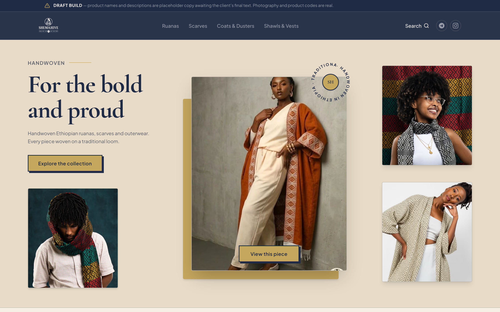
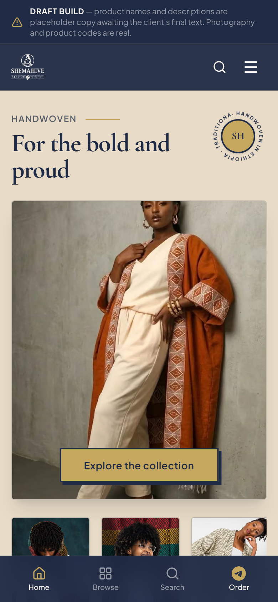
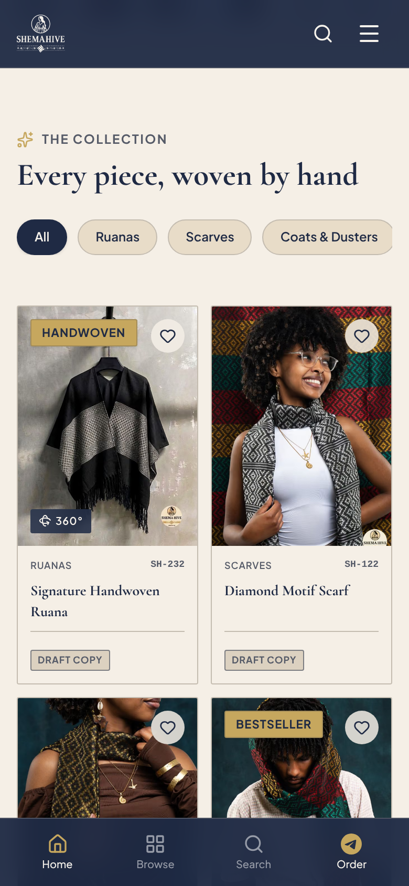
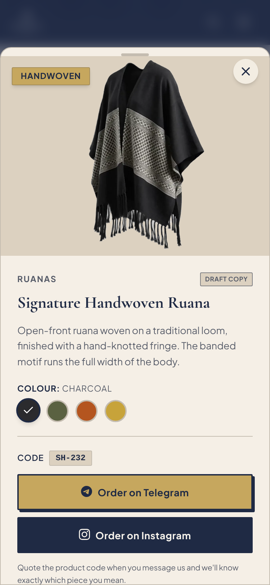

# Shema Hive

A showcase catalogue for Shema Hive, a label making handwoven Ethiopian ruanas, scarves and outerwear on a traditional loom. It is for shoppers who want to look closely at a piece and then order it by messaging the seller, which is how Shema Hive sells.

**Live:** [shema-hive-ecru.vercel.app](https://shema-hive-ecru.vercel.app)

| | |
|---|---|
| **Design** | Fraol Tamrat: research, concept, visual system, UX and content structure |
| **Development** | Claude Code, working from my design and under my direction |
| **Client** | Shema Hive |
| **Stack** | Next.js 16, React 19, TypeScript, Tailwind CSS 4, Framer Motion |

## Screenshots



<p>
  
  
  
</p>

The "Draft build" banner and "Draft copy" chips in these shots are part of the design. They mark placeholder text and are explained under [Status](#status).

## The brief

Shema Hive sells through conversation. A shopper sees a piece, messages the seller on Telegram or Instagram, and the order is arranged there. There is no checkout, and pricing for the site was not confirmed.

That leaves a specific problem. A normal store template assumes a cart, a price on every card and an account, and none of those would lead anywhere here. At the same time, the product is woven cloth, and its value is in the pattern, the fringe and the way it hangs. A shopper cannot judge those from a single front-facing photo.

So the design had to do two things: show the cloth well enough that someone wants a particular piece, and make it effortless to tell the seller which piece that is.

## The concept

**A showcase that ends in a conversation.** The site's job is finished when the shopper has opened a chat knowing exactly what to ask for. Everything that belongs to a shop but not to that moment was left out.

The rules that follow from it:

- **Colour.** Three colours only: navy `#1F2A44`, beige `#E8DCC8` and gold `#C6A75E`. Beige is the page, navy is text and the header, and gold is the scarce one, kept for calls to action and badges.
- **Type.** Cormorant Garamond for headings, Plus Jakarta Sans for everything you read or tap. The serif carries the heritage, the sans keeps the interface plain.
- **Layout.** The client's own photography leads every screen. The hero is built from real pieces, and each card is mostly image.
- **Refused.** No cart, no accounts, no prices, no star ratings or review counts, no stock photography, and no footer links to policy pages that do not exist. If something could not be backed by real content, it is absent or labelled as a placeholder.

## Design decisions

**Ordering is a message, with a product code.** Every piece ends in two buttons, Order on Telegram and Order on Instagram. Neither platform lets a link prefill a message, so each product carries a short code such as `SH-232`, shown right above the buttons. The shopper quotes it and the seller knows the piece.

**The seller and the brand are separate links.** "Order" goes to the person who takes orders. "Follow" goes to the brand's channels. They sit in different places and are never swapped, so someone ready to buy does not land on a feed, and someone browsing does not land in a private chat.

**Gold is never text on a light surface.** Gold on beige measures 1.71:1 and white on gold 2.31:1, so the pairing that looks most luxurious is the one nobody can read. Gold appears as filled buttons and badges with navy text on top (6.17:1), and as hairlines and icon strokes. All reading text on beige is navy (10.53:1).

**The in-between colours come from the palette.** Three colours do not cover secondary text, borders or raised panels. Those neutrals are blends of navy and beige, each checked against a WCAG contrast target, and all of them live as named tokens in one stylesheet. No component carries its own hex value.

**A 360° view where the cloth needs it.** The signature ruana can be dragged through a full turn in three of its colourways, so the shopper sees the open front, the back panel and the fringe. It is a sequence of 36 still frames, one every 10°, which responds instantly to a finger. Vertical swipes still scroll the page, arrow keys rotate it, and people who prefer reduced motion get a still image with the option to open the spin.

**Not every piece has a spin, and that has to look intentional.** The fourth colourway of the same ruana has no 360° set and shows its photograph instead, as does every other product. A small "360°" tag on the card says which pieces have one, so nobody goes looking for a feature that is not there.

**Placeholder text says it is placeholder.** The product names and descriptions are not the client's final words yet. A banner at the top of the page and a chip on each card say so, and one setting removes both when the real copy arrives. A draft should not be able to pass for a finished site.

## How it was built

I wrote the design as briefs: the palette with its measured contrast ratios, the rules for where gold may appear, what to remove, how the 360° viewer should behave, and a checklist for what counted as done. Claude Code implemented from those briefs.

The work was review-driven. Claude Code stopped at set checkpoints and came back with questions where the material needed a decision from me, and I reviewed and merged the result. The briefs asked for outcomes that could be checked, such as "dragging back returns the product to the same angle", and the implementation was tested against them: contrast across the rendered pages, layout at 375, 768, 1280 and 1920 px, and the viewer's rotation in both directions.

The page skeleton was carried over from an earlier storefront build that began from a reference layout. This project replaced its palette, type, content and purchase flow.

The 360° frames come from three product clips. They needed work before they could be used: the rotation speed was uneven, each clip held about two turns, and a grey checkerboard was baked into the background. A script in `tools/` measures the garment's angle in every frame, picks 36 evenly spaced ones from a single turn, and removes the background.

## Status

Finished:

- The rebrand: palette, type, logo in light and dark variants, site name and metadata
- A catalogue of 11 pieces in four categories, using the client's photography and product codes
- Category filters, search, Quick View with colour swatches, and the Telegram and Instagram order flow
- The 360° viewer on the signature ruana in charcoal, olive and rust
- Responsive layout with a bottom navigation bar on phones

Placeholder or pending:

- **Product names and descriptions are placeholder copy.** The site labels them on screen.
- **Badges** such as "Bestseller" and "Limited" have not been confirmed by the client.
- **No prices.** Currency and pricing were not confirmed, so none are shown.
- **No shipping, returns or size-guide pages.** They were left out and not invented.
- **The 360° viewer has not had a Lighthouse pass or a test on a physical phone.** It was checked in emulated phone viewports. Each colourway's frame set is about 2.5 MB.
- **The 360° source clips are low resolution** (720 px wide). A higher-resolution clip with one turn at constant speed would improve the result.

## Run it locally

You need Node.js 20 or newer.

```bash
npm install
```

```bash
npm run dev
```

Then open <http://localhost:3000>.

| Command | What it does |
|---|---|
| `npm run dev` | Start the development server |
| `npm run build` | Build for production |
| `npm run start` | Serve the production build |
| `npm run lint` | Run ESLint |

Set `NEXT_PUBLIC_SITE_URL` to the site's address when deploying, so social-card images resolve. It is optional for local work.

```
src/app/            Page, layout, and globals.css with the design tokens
src/components/     Header, hero, catalogue, Quick View, 360° viewer, order buttons
src/data/           Brand details, contact links and the product catalogue
src/types/          Product and colourway types
public/brand/       Logo variants and favicon
public/products/    Product photography and the 360° frame sets
tools/build360.py   Builds a 36-frame set from a source clip (Python 3, numpy, Pillow, imageio-ffmpeg)
docs/screenshots/   The images in this README
```

To rebuild a 360° set:

```bash
python tools/build360.py --clip main --out public/products/360/ruana-charcoal
```
